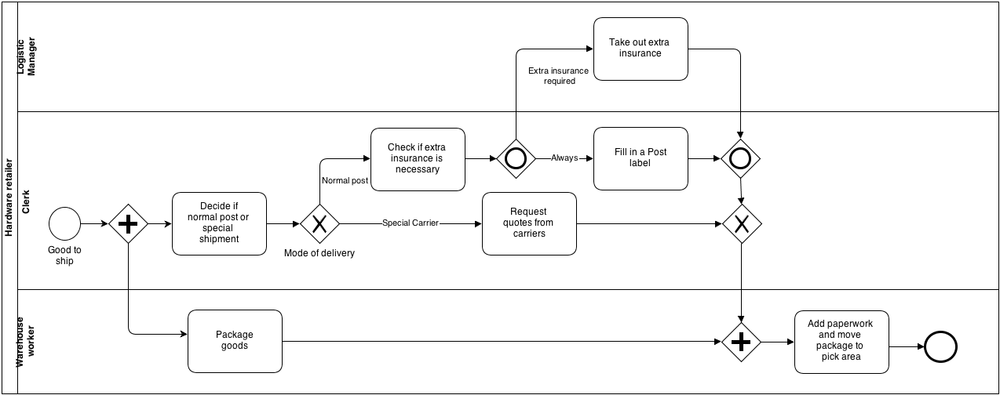

# Viewflow

**The low-code for developers with yesterday's deadline**

[![build]][build] [![coverage]][coverage] [![pypi-version]][pypi] [![py-versions]][pypi]

Viewflow is a low-code library for building business applications with Django.
It gives you ready-made components for user management, workflows, and
reporting. You write less code but keep full control. You can customize
everything and connect it to your existing systems.

Build full-featured business applications in a few lines of code. Viewflow ships
as one package with everything included. Each part works on its own, but they
all work well together.

GPT assisted with Viewflow documentation: [Viewflow Pair Programming Buddy][gpt]

Viewflow comes in two versions:

- **Viewflow Core:** Open-source library with base classes. Build your own solution on top.
- **Viewflow PRO:** Full package with ready-to-use features and third-party integrations. Commercial license allows private forks and modifications.



## Features

- Modern, responsive interface with SPA-style navigation
- Reusable workflow library for BPMN processes
- Built-in CRUD for complex forms and data
- Reporting dashboard included
- Small, easy-to-learn API

## Installation

Viewflow works with Python 3.10+ and Django 4.2+

Viewflow:

    pip install django-viewflow

Viewflow PRO:

    pip install django-viewflow-pro  --extra-index-url https://pypi.viewflow.io/<licence_id>/simple/

Add to INSTALLED_APPS in settings.py:

```python
    INSTALLED_APPS = [
        ....
        'viewflow',
        'viewflow.workflow',  # if you need workflows
    ]
```

## Quick start

Here is a pizza ordering workflow example.

### 1. Create a model for process data

Viewflow provides a Process base model. Use jsonstore fields to store data
without extra database joins:

```python

    from viewflow import jsonstore
    from viewflow.workflow.models import Process

    class PizzaOrder(Process):
        customer_name = jsonstore.CharField(max_length=250)
        address = jsonstore.TextField()
        toppings = jsonstore.TextField()
        tips_received = jsonstore.IntegerField(default=0)
        baking_time = jsonstore.IntegerField(default=10)

        class Meta:
            proxy = True
```

### 2. Create flows.py with your workflow

Define a flow class with steps. Use CreateProcessView and UpdateProcessView for
the forms:

```python

    from viewflow import this
    from viewflow.workflow import flow
    from viewflow.workflow.flow.views import CreateProcessView, UpdateProcessView
    from .models import PizzaOrder

    class PizzaFlow(flow.Flow):
        process_class = PizzaOrder

        start = flow.Start(
            CreateProcessView.as_view(
                fields=["customer_name", "address", "toppings"]
            )
        ).Next(this.bake)

        bake = flow.View(
            UpdateProcessView.as_view(fields=["baking_time"])
        ).Next(this.deliver)

        deliver = flow.View(
            UpdateProcessView.as_view(fields=["tips_received"])
        ).Next(this.end)

        end = flow.End()
```

### 3. Add URLs

Register the workflow with the frontend:

```python

    from django.urls import path
    from viewflow.contrib.auth import AuthViewset
    from viewflow.urls import Application, Site
    from viewflow.workflow.flow import FlowAppViewset
    from my_pizza.flows import PizzaFlow

    site = Site(
        title="Pizza Flow Demo",
        viewsets=[
            FlowAppViewset(PizzaFlow, icon="local_pizza"),
        ]
    )

    urlpatterns = [
        path("accounts/", AuthViewset().urls),
        path("", site.urls),
    ]

```

### 4. Run migrations and start the server

Run migrations, start Django, and open the browser. You can now create and track
pizza orders through the workflow.

Next steps: https://docs.viewflow.io/workflow/writing.html

## Documentation

Latest version: http://docs.viewflow.io/

Version 1.xx: http://v1-docs.viewflow.io

## Demo

http://demo.viewflow.io/

## Cookbook

Code samples and examples: https://github.com/viewflow/cookbook

## Stay updated

[Subscribe to our newsletter][newsletter] for release notes, Django low-code
tips, and notes on shipping business apps fast.

## License

Viewflow is an Open Source project licensed under the terms of the AGPL license - [The GNU Affero General Public License v3.0](http://www.gnu.org/licenses/agpl-3.0.html) with the Additional Permissions
described in [LICENSE_EXCEPTION](./LICENSE_EXCEPTION)

The AGPL license with Additional Permissions is a free software license that
allows commercial use and distribution of the software. It is similar to the GNU
GCC Runtime Library license, and it includes additional permissions that make it
more friendly for commercial development.

If you use Linux already, this package license likely won't bring anything new to your stack.

Viewflow PRO has a commercial-friendly license allowing private forks and
modifications of Viewflow. You can find the commercial license terms in
[COMM-LICENSE](./COMM-LICENSE).

## Changelog

For older releases, see [CHANGELOG.rst](./CHANGELOG.rst).

## 2.4.0 2026-07-30

The largest feature release of the 2.x line: complete BPMN 2.0 node coverage,
document-oriented JSON Store fields, and a drop-in replacement for django-fsm.

**Workflow and BPMN**

- New database-backed `flow.Timer` and `flow.StartTimer(interval=...)` nodes. The
  due moment is stored on the task row (new `Task.scheduled` field, migration
  included), so a timer survives a broker restart, unlike `celery.Timer`. Due
  timers fire from the `workflow_timers` management command or the
  `workflow_fire_timers` celery beat task
- Boundary events, declared on the host task before `.Next()`:
  `.OnTimeout(delay, then)` for deadlines and escalation, `.OnError(then, code=...)`
  to catch a background task failure. Interrupting by default;
  `interrupting=False` starts a parallel path
- `flow.TerminateEnd()` cancels all other active tasks and finishes the process;
  `flow.ErrorEnd(code)` fails it. Inside a subprocess, `ErrorEnd` marks the parent
  task `ERROR`, so the parent's `.OnError(..., code=...)` boundary catches it
- Compensation: `.CompensateWith(this.handler)` registers an undo handler on any
  task, and `flow.CompensateThrow()` runs the handlers of completed tasks in
  reverse completion order, each at most once
- New intermediate events: `MessageCatch`/`MessageThrow`,
  `SignalCatch`/`SignalThrow` (one throw releases every armed catch, across
  processes and flow classes), `EscalationThrow` with a non-interrupting
  `.OnEscalation` boundary, and `ConditionalCatch`, which waits until a condition
  over process data holds
- New task types: `flow.SendHandle`, `flow.BusinessRule`, and `flow.ManualTask`
  for work done outside any system, marked done with a no-field confirmation.
  `NSubprocess(..., sequential=True)` runs one child process at a time
- BPMN 2.0 export overhaul: exported files validate against the official OMG
  schema and open in bpmn.io and Camunda Modeler. `Switch`, `Subprocess` and
  `NSubprocess` are no longer dropped from the export, `Handle` maps to a receive
  task, celery `Job` to a service task, and the new nodes above to their real BPMN
  counterparts. Download a flow as `.bpmn` from the chart view, the REST API
  (`?format=bpmn`), the diagram dialog, or the `flowexport` command
- Chart layout: empty grid rows and columns are collapsed, cell collisions
  resolved, parallel edge channels staggered and routed around node shapes, and
  `If` branches labeled yes/no
- The flow diagram dialog is now pan- and zoom-able: scroll to zoom toward the
  cursor, drag to pan, pinch on touch, double-click to reset
- Every built-in control node is cancellable, `Flow.cancel` raises the intended
  `FlowRuntimeError` instead of `AttributeError` for a node with no `cancel`
  transition, and the process cancel view refuses cleanly instead of returning a
  500 when a task can't be cancelled
- `flow.View` gained a `reassign_view_class` hook that finishes the built-in
  reassign transition and shows a "Reassign" action on the task (off by default)
- New cookbook samples, all in application code with no core changes:
  `substitute` (reassignment), `snooze` (hide a task from the inbox until a chosen
  time, #219), and `dynamic_subprocess` (attach another `NSubprocess` child while
  the parent task still runs, #258)

**JSON Store**

- Relation fields stored inside the JSON document, with no column, migration or
  join table: `jsonstore.ForeignKey` (pk under `<name>_id`, lazy load,
  `ModelChoiceField` in forms), `jsonstore.OneToOneField`, and
  `jsonstore.ManyToManyField` (a manager with
  `all`/`add`/`remove`/`set`/`clear`/`count`). Non-integer primary keys, e.g.
  `UUIDField`, are supported (#366)
- `jsonstore.EmbeddedModel` with `EmbeddedField` and `EmbeddedListField`:
  schema-only virtual models (typed fields, no table) stored as a nested JSON
  document, or a list of them. Embedded models nest, and reading returns an
  instance bound to the stored sub-document, so in-place edits are saved
- `viewflow.forms` edits embedded documents as nested forms: `EmbeddedModelForm`
  builds a form from an embedded schema, and `EmbeddedFormField` /
  `EmbeddedFormSetField` bind it to the model field, so a document edits as a
  nested form and a list of them as inlines, all in one JSON column. New
  `cookbook/embed101` demo
- New field types: `BigIntegerField`, `SmallIntegerField`, the three
  `Positive*IntegerField`s, `SlugField`, `FilePathField`, `UUIDField`,
  `DurationField` (ISO-8601, read back as a `timedelta`) and `BinaryField`
  (base64, read back as `bytes`)
- A `json_key` argument controls where a value lives in the document: a custom
  key, or a list/tuple for a nested path (`json_key=("address", "city")`), honored
  by reading, writing, filtering and ordering for every field type

**FSM**

- `viewflow.fsm.FSMField`: a same-column drop-in for django-fsm's `FSMField`.
  Swap the import and `@transition(field=..., source=..., target=...)` keeps
  working, on top of the `conditions`/`permission`/`on_success` machinery
  `viewflow.fsm` already has. Two guarantees django-fsm didn't have are opt-in and
  off by default: `protected=True` blocks direct assignment after the first value
  is set, and `enforce_initial=True` raises `NonInitialStateOnCreate` when a new
  row would be inserted at a non-default value
- Dynamic transition targets, ported from django-fsm:
  `target=State.RETURN_VALUE(*states)` takes the target from the method's return
  value, and `target=State.GET_STATE(func, states=[...])` computes it from the
  call's arguments before the method runs. Declared states are charted and
  enforced with `InvalidTargetState`
- `TransitionNotAllowed` split into `NoTransition` (nothing registered from the
  current state) and `TransitionConditionsUnmet` (a `conditions=` callback
  returned false, carrying the failed condition and its message). Existing
  `except TransitionNotAllowed` handlers keep working
- The `FlowViewsMixin` list page shows the state diagram next to the object table
  in a click-to-zoom dialog, exportable as PNG. The admin change-list diagram no
  longer blows out the filter sidebar

**Viewsets and forms**

- A virtual list column (a viewset or model method or property) can be made
  sortable with `orderby_column` — a field lookup like `"data__price"`, or a query
  expression like `Cast("data__price", IntegerField())` for a numeric sort (#361)
- Bulk actions now scope their queryset through the viewset's
  `get_queryset(request)`, so "Select All" no longer touches rows outside the
  viewset's scope, and no longer crash for a viewset with no configured filter
  (#422)
- `InlineFormSetField` and the other composite fields honor a field-level
  `initial=[...]` as a fallback, so pre-populated formset rows render their values
- `process_dashboard.html` exposes a `flow_start_card_actions` block, so projects
  can add start-card controls by extending the template instead of copying it

Plus fixes for a 500 on the admin process changelist (#523) and on the task detail
page of an unregistered subprocess. See [CHANGELOG.rst](./CHANGELOG.rst) for the
full list.


[build]: https://img.shields.io/github/actions/workflow/status/viewflow/viewflow/django.yml?branch=main
[coverage]: https://img.shields.io/coveralls/github/viewflow/viewflow/v2
[travis-svg]: https://travis-ci.org/viewflow/viewflow.svg
[travis]: https://travis-ci.org/viewflow/viewflow
[pypi]: https://pypi.org/project/django-viewflow/
[pypi-version]: https://img.shields.io/pypi/v/django-viewflow.svg
[py-versions]: https://img.shields.io/pypi/pyversions/django-viewflow.svg
[requirements-svg]: https://requires.io/github/viewflow/viewflow/requirements.svg?branch=v2
[requirements]: https://requires.io/github/viewflow/viewflow/requirements/?branch=v2
[gpt]: https://chatgpt.com/g/g-8UHAnOpE3-viewflow-pair-programming
[newsletter]: https://robustarush.substack.com/?utm_source=github&utm_medium=readme&utm_campaign=viewflow_oss
